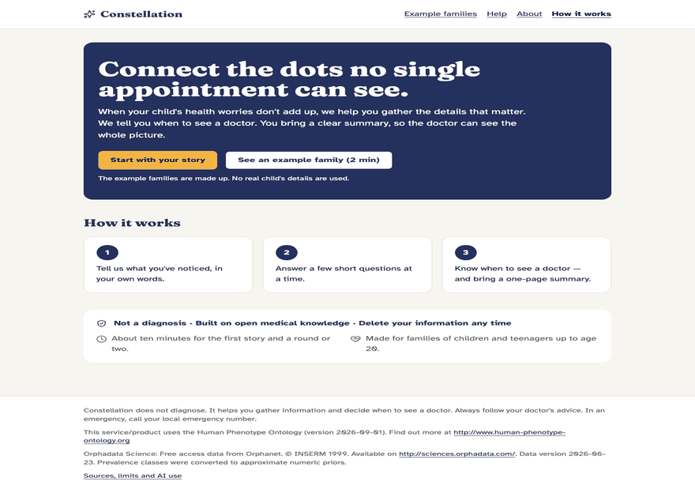
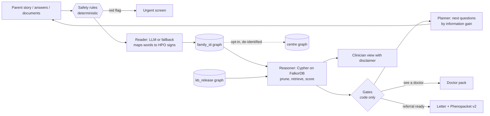
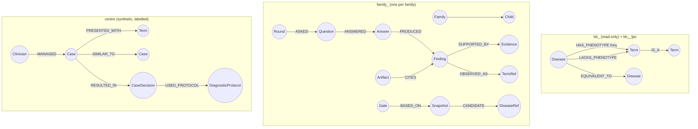

# Constellation

> **Not a diagnosis tool.** Constellation helps families gather evidence and reach the right specialist sooner.
> It never shows a parent a disease name, a probability or a ranking.

Built for the WeMakeDevs × FalkorDB **Graph Hacks** hackathon, entered in all three tracks.

| | |
|---|---|
| Live demo (replay mode, no key) | **TODO (human):** add the URL after deploying, see [docs/submission/deploy.md](docs/submission/deploy.md) |
| Demo video (≤ 3 min) | **TODO (human):** record from [docs/submission/video_script.md](docs/submission/video_script.md) |
| Blog post | **TODO (human):** write from [docs/submission/blog_outline.md](docs/submission/blog_outline.md) |
| 5-minute tour | [docs/USER_GUIDE.md](docs/USER_GUIDE.md) |

## 1. Why

Children with a rare condition often wait years for the right specialist. Parents notice real signs (late
walking, odd movements, a growth curve that bends) but cannot tell which ones matter, and a visit is short.
A search engine or a chatbot will happily name diseases, which frightens families and is not safe.

Constellation takes a different job: **help the family collect the evidence, then say clearly when it is
time to see a doctor.** The parent tells the story in plain words. The agent asks small rounds of plain
questions. When the evidence is strong enough it says "see a doctor" and prints a one-page doctor pack. When
the doctor's findings come back and the pattern fits rare conditions strongly, it drafts a referral letter and a
[GA4GH Phenopacket v2](https://phenopacket-schema.readthedocs.io/) file. Then it keeps watching, for years.
Candidate conditions appear only in the clinician view, with a disclaimer.

## 2. What it does



*(A slideshow of screenshots of the made-up example families, generated by `scripts/make_gif.py`; the screen recording is in the demo video.)*

1. **Story.** The parent writes what they have noticed. A deterministic safety layer reads it first
   (red flags such as breathing trouble, seizures, a baby under three months with a fever, a teenager in crisis).
2. **Rounds of questions.** Each round asks a handful of plain questions chosen by the graph, each with a
   one-line reason and a "how to check at home" hint. "Not sure" is always allowed.
3. **Gates.** *Keep watching*, *mention it at the next visit*, *see a doctor*, *referral ready*, or *urgent*.
   Code decides, never the language model.
4. **Doctor pack, referral and Phenopacket.** One printable page with a QR code for the clinician view.
5. **Watching.** A daily watcher re-scores each family when knowledge or findings change and notifies once.
6. **Centre brain.** A clinic sees look-alike solved cases, *who* solved them and *with which protocol*,
   signs that bridge groups of cases, and what a knowledge update would change. All clinic data is
   **synthetic and labelled so**.

## 3. Try it

You need Docker, [uv](https://docs.astral.sh/uv/), Node 22 with pnpm, and `make`. No API key is needed:
the demos run in replay mode and every language step has a deterministic fallback.

```bash
make setup         # Python and web dependencies
make data up       # download the pinned public data (checksummed), start FalkorDB + API + web
make seed          # build the knowledge graphs and the synthetic clinic (a few minutes)
```

Open <http://localhost:8080>. Stop with `make down`. The demo pages are static recordings and always work. If you restart FalkorDB (or `make down` then `make up`) its graphs reload from a snapshot, and free-text term search can rank slightly differently than in the recordings (so `make demo-replay` may report a difference); `make reset` wipes the volume and rebuilds everything from scratch, which is deterministic ([docs/VERIFIED.md](docs/VERIFIED.md)).
[docs/USER_GUIDE.md](docs/USER_GUIDE.md); the fastest path is **"Use an example story"** on the first page,
then **/demo** for the three recorded journeys (Kabir: from a worried story to a referral; Arjun: reassurance;
Maya: an urgent red flag).

**Language model.** Without a key the app uses its deterministic fallbacks (story reading is coarser). To let
Claude read stories and documents, put `ANTHROPIC_API_KEY` in a local `.env` file and set `LLM_MODE=live`;
`make llm-key-check` reports whether the key is set (never its value). The public demo runs in replay mode;
live mode is rate limited with a daily token budget (`config/llm.yaml`).
**Cost per family journey: not measured.** No key was available during the build, so we do not quote a figure
(see [ADR-0009](docs/adr/0009-llm-profiles.md)); `make llm-contract` measures it once a key is set.

Other commands: `make check` (lint, types, unit tests), `make test-int` (against FalkorDB), `make e2e`,
`make eval-smoke`, `make demo-replay`, `make audit`. Deployment: [docs/submission/deploy.md](docs/submission/deploy.md).

## 4. How it works



- **Safety first** ([`backend/app/safety/`](backend/app/safety), rules in [`review/safety_rules.yaml`](review/safety_rules.yaml),
  human-reviewed). Runs on every message, answer batch and document before anything else. A model may add a flag, never remove one.
- **Code decides, the model talks** ([`backend/app/engine/`](backend/app/engine)). Scores, rankings and gates are arithmetic on rows
  returned by Cypher. The model only turns words into signs and signs into friendly questions.
- **One LLM port.** Everything goes through `LLMPort` ([`backend/app/llm/`](backend/app/llm)); only the adapter imports the
  `anthropic` SDK; model ids live only in [`config/llm.yaml`](config/llm.yaml). Each task has a deterministic fallback, and a daily
  budget drops the public live mode back to the fallbacks.
- **Parent-safe by construction.** The parent API has a separate schema with no disease fields; an end-to-end test scans every
  parent page for ~19,700 disease names and banned words.
- **Privacy.** No accounts, names, dates of birth or locations (age in months). Family access is a capability token. The public
  demo erases families after 7 days. Only opted-in, de-identified term sets reach the centre.

## 5. FalkorDB inside

FalkorDB (pinned `falkordb/falkordb:6.0.2`) is the memory *and* the reasoning substrate. Every round runs as parameterised,
timed, read-only Cypher from a query registry ([`backend/app/graph/queries/`](backend/app/graph/queries), 100+ named `.cypher` files,
each with an integration test). Python only does arithmetic on the returned rows; the single in-memory structure is the HPO
ancestor-set cache.

### Graphs



The full property lists are in [spec §11](docs/spec/09-graph-model.md). The checkpointer is `langchain-falkordb` `FalkorDBSaver`
(thread id `family_<id>`), so an interrupted conversation resumes after a process restart (test: two real subprocesses).
An MCP server exposes four tools (`resolve_phenotype`, `rank_candidates`, `explain_candidate`, `centre_route_case`).

### Cypher and algorithms used

| What | Where | FalkorDB feature |
|---|---|---|
| Map a parent's words to HPO signs | [`q0_fulltext`](backend/app/graph/queries/q0_fulltext.cypher), [`q0_vector`](backend/app/graph/queries/q0_vector.cypher) | full-text index, vector index (384-d, cosine) |
| Drop redundant findings (ancestor of another) | [`q1a_redundant_present`](backend/app/graph/queries/q1a_redundant_present.cypher), [`q1b_redundant_absent`](backend/app/graph/queries/q1b_redundant_absent.cypher) | variable-length `IS_A*` traversal |
| Candidate retrieval: exact, broader, not-present, absent | [`q2a`](backend/app/graph/queries/q2a_exact_or_specific.cypher), [`q2b`](backend/app/graph/queries/q2b_broader.cypher), [`q2c`](backend/app/graph/queries/q2c_not_present.cypher), [`q2d`](backend/app/graph/queries/q2d_absent.cypher), [`q2e`](backend/app/graph/queries/q2e_not_absent.cypher) | multi-hop `HAS_PHENOTYPE` over the ontology |
| Next questions (askable terms, information gain inputs) | [`q3a_annotations`](backend/app/graph/queries/q3a_annotations.cypher), [`q3b_askable`](backend/app/graph/queries/q3b_askable.cypher) | traversal + aggregation |
| "Why this?" explanation paths | [`q4_explain_path`](backend/app/graph/queries/q4_explain_path.cypher), [`q4b`](backend/app/graph/queries/q4b_explain_path_down.cypher) | path return |
| OMIM ↔ ORPHA equivalence | [`q5_exact_equivalents`](backend/app/graph/queries/q5_exact_equivalents.cypher) | `EQUIVALENT_TO` edges |
| Family memory (findings, rounds, gates, artifacts, history) | [`f_*.cypher`](backend/app/graph/queries) (38 files) | one graph per family, `GRAPH.DELETE` on erasure |
| Centre routing: look-alikes, who solved them, which protocol | [`q7_centre_routing`](backend/app/graph/queries/q7_centre_routing.cypher) | materialised ancestor closure, IC-weighted overlap |
| Bridge signs | [`q8a_bridges`](backend/app/graph/queries/q8a_bridges.cypher) | `algo.betweenness` |
| Case groups | [`q8b_wcc`](backend/app/graph/queries/q8b_wcc.cypher), [`q8c_label_propagation`](backend/app/graph/queries/q8c_label_propagation.cypher) | `algo.WCC`, `algo.labelPropagation` |
| Knowledge-update what-if | [`c_whatif_*`](backend/app/graph/queries) | `GRAPH.COPY` |

Verified FalkorDB facts, bugs and workarounds (including a 6.0.2 panic we hit and how the registry avoids it) are in
[docs/VERIFIED.md](docs/VERIFIED.md); Cypher guardrails in [docs/FALKORDB_CHEATSHEET.md](docs/FALKORDB_CHEATSHEET.md).
The **live inspector**: start "Use an example story" and open the *FalkorDB inspector (live)* link on the journey page to see the Cypher FalkorDB runs for
that family, with rows and milliseconds ([ADR-0016](docs/adr/0016-live-inspector-for-example-families.md)). The `/demo/*` pages replay the queries recorded
when each example family was run, and the centre dashboard has its own live query log.

### Tracks

- **Track 2, Agent Memory (primary):** a graph per family for years, checkpointed agent state, handoffs through shared state.
- **Track 1, Agents That Act on Connected Data (co-primary):** multi-hop HPO traversal decides questions and gates, which trigger the
  doctor pack, referral and watcher; MCP tools; explanation paths.
- **Track 3, Company Brain (secondary):** the centre: who knows what, decisions traced to source, knowledge kept current.

## 6. Evaluation

Real published cases ([Phenopacket Store](https://github.com/monarch-initiative/phenopacket-store) 0.1.27) with **simulated** parent answers.
This is not a clinical validation. The test split (by publication, SHA-256 `223e6076…b6d5`) was frozen before any tuning and evaluated once
(pre-registered in [ADR-0013](docs/adr/0013-frozen-evaluation-preregistration.md)). Headline = the leave-publication-out knowledge graph
(`kb_<release>_lpo`: rows citing a test publication removed), exact mappings only, 5,336 test cases:

| Method | top-1 % [95% CI] | top-10 % [95% CI] |
|---|---|---|
| B0 story only | 2.5 [2.1, 2.9] | 11.8 [10.9, 12.7] |
| B1 random questions ×4 | 2.7 [2.3, 3.1] | 12.3 [11.4, 13.2] |
| B2 most-frequent questions ×4 | 3.6 [3.1, 4.1] | 13.2 [12.3, 14.1] |
| **Ours**, 4 rounds | 3.4 [3.0, 4.0] | 13.0 [12.1, 13.9] |
| **Ours**, after the doctor visit | 3.8 [3.3, 4.3] | 14.3 [13.4, 15.2] |

**Honest reading.** Our paired top-10 gain over the story-only baseline is small (+0.7 to +1.7 points). **We do not beat the
"most-frequent questions" baseline B2** (paired difference −0.7 to +0.3 points); on the dev split it was level too (ADR-0007). Only 68.7% of test
targets are still annotated once their own publications are removed, which caps every method. Candidate ranking is not the product's
claim: the claim is *safe, earlier* escalation, and there the numbers are modest too: referral sensitivity 12.8%, "see a doctor"
issued at round 1 for 58.8% of cases; on 40 reviewed synthetic common-condition vignettes, **0% false referrals** and 22.5% false
"see a doctor" advice; the safety-rules-only floor is 0%. Published numbers for other systems (for example GPT-4 19.2% top-1) use other data
and are context only. Full report with the leaky standard-kb numbers, sensitivity to the simulated parent and the threshold sweep:
[eval/reports/2026-10-16-test.md](eval/reports/2026-10-16-test.md). Latency: median round 279 ms (p90 465 ms), centre routing p90 under 100 ms.

## 7. Data and credits

- **Human Phenotype Ontology.** This service/product uses the Human Phenotype Ontology (version 2026-09-01). Find out more at
  <http://www.human-phenotype-ontology.org>. Gargano MA, et al. The Human Phenotype Ontology in 2024: phenotypes around the world.
  *Nucleic Acids Res.* 2024;52(D1):D1333-D1346. doi:10.1093/nar/gkad1005. HPO content is loaded unmodified; our own labels are separate `cx_*` properties.
- **Orphadata Science:** Free access data from Orphanet. © INSERM 1999. Available on <http://sciences.orphadata.com/>. Data version 2026-06-23. CC BY 4.0.
  Change made: prevalence classes converted to approximate numeric priors.
- **Phenopacket Store** 0.1.27 (BSD-3-Clause, © 2022 Monarch Initiative). Danis et al., *HGG Advances* 2025, 6(1):100371.
- **Embeddings:** `BAAI/bge-small-en-v1.5` (MIT), run locally.
- OMIM-sourced IEA annotations are excluded unless `KB_INCLUDE_OMIM_IEA=true`.

Exact licence texts: [docs/DATA_LICENSES.md](docs/DATA_LICENSES.md). Only public, licensed or synthetic data is used; no real patient data.
Frozen test split: `eval/splits/test_ids.txt`, 7,496 cases.

## 8. Limits and what's next

- Not clinically validated; simulated answers are cleaner than real parents'. A regulatory path is needed before any clinical use.
- Knowledge is only as good as HPO annotations; dropping OMIM-sourced IEA rows reduces coverage for some OMIM-only diseases.
- The common-explanation class, multi-system decay and organ dampening are heuristics tuned on synthetic negatives.
- Clinic data (clinicians, protocols, decisions) is synthetic.
- English only. Lay-term coverage depends on HPO layperson synonyms plus generated labels.
- No language-model key was available during the build: the Claude profiles in `config/llm.yaml` are **defaults, not measured**, the recorded
  demos were produced with the deterministic fallbacks, and the cost per journey is unknown. Run `make llm-contract` with a key to measure.
- Known demo gaps (without a key the clinician view shows some noisy findings) are listed in
  [`.build/STATE.md`](.build/STATE.md).
- Published cases may appear in LLM training data (this affects an LLM baseline, not our engine's scoring).

## 9. Tracks

Track 2 *Agent Memory* (primary), Track 1 *Agents That Act on Connected Data* (co-primary), Track 3 *Company Brain* (secondary);
plus the blog-post side prize. Details in section 5.

## 10. Built with AI assistants

This project was built with Claude Code (Sonnet 5.5 as the working model, Opus as an advisor) running autonomously from a human-written, locked
specification. The human chose the problem, did the research, wrote the product and technical design and the locked decisions, reviewed and
approved every file in `review/` (safety rules, 40 common-case vignettes, demo stories, doctor letters), and made the gate decisions (for example
the P2 result in ADR-0007). Claude drafted the code, tests, ADRs, explanations and the first drafts of the `review/` files.
Who drafted and who reviewed each part, including what is **still pending human review**, is recorded truthfully in
[docs/AI_USAGE.md](docs/AI_USAGE.md); plain-English explanations of every phase are in [docs/explain/](docs/explain). AI-written text is never presented as human-written.

**Team:** TODO (human).

## 11. Licence

MIT. See [LICENSE](LICENSE).
