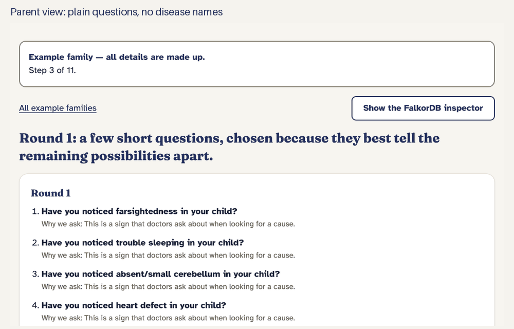
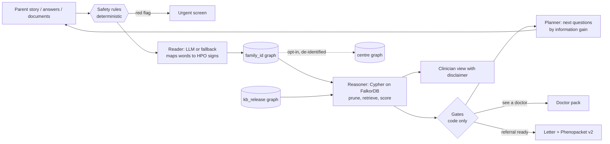
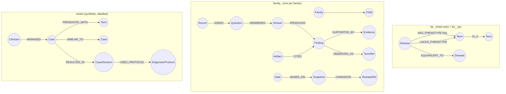

# Constellation

**A long-running memory for families of children with unexplained symptoms: the parent gets plain questions, the doctor gets evidence and a one-page pack, and FalkorDB does the reasoning. It never diagnoses.**

[](https://github.com/dev-seek/Graph_Hacks/actions/workflows/ci.yml)
-lightgrey)

-red)




*Hero GIF (16 s): Playwright captures of the recorded Kabir journey in replay mode (a made-up family), stitched with Pillow by
[`scripts/make_hero_gif.py`](scripts/make_hero_gif.py), capture spec [`web/e2e/hero.spec.ts`](web/e2e/hero.spec.ts). The inspector frame shows the
recorded run of that round's queries; the live inspector is in step 1 of the judge path below.*

> **Honest limits and AI disclosure, up front.** Not clinically validated; simulated parents; we **tie** (not beat) the simple frequent-question baseline
> ([evaluation](#6-evaluation-honestly), [ADR-0007](docs/adr/0007-p2-gate-outcome.md)); no language-model key was available, so Claude profiles and per-journey cost are
> **unmeasured**; nothing is deployed yet ([limits](#8-honest-limits-and-whats-next)). Built with Claude Code from a human-written locked spec
> ([DECISIONS.md](docs/DECISIONS.md)); the human chose the problem, designed the product, reviewed the safety rules, vignettes, stories and letters and made the gate calls;
> Claude drafted the code, tests and docs. Who did what, row by row, including what is still pending human review: [docs/AI_USAGE.md](docs/AI_USAGE.md), [disclosure](#10-built-with-ai-assistants).

| | |
|---|---|
| Live demo (replay mode, no key) | **TODO (human):** URL after deploying, see [docs/submission/deploy.md](docs/submission/deploy.md) |
| Demo video (≤ 3 min) | **TODO (human):** record from [docs/submission/video_script.md](docs/submission/video_script.md) |
| Blog post | **TODO (human):** write from [docs/submission/blog_outline.md](docs/submission/blog_outline.md) |
| 5-minute tour | [docs/USER_GUIDE.md](docs/USER_GUIDE.md) |

## 1. Why

Children with a rare condition often wait years for the right specialist. Parents notice real signs (late
walking, odd movements, a growth curve that bends) but cannot tell which ones matter, and a visit is short.
A search engine or a chatbot will happily name diseases, which frightens families and is not safe.

Constellation takes a different job: **help the family collect the evidence, then say clearly when it is
time to see a doctor.** The parent tells the story in plain words. The agent asks small rounds of plain
questions. When the evidence is strong enough it says "see a doctor" and prints a one-page doctor pack. When
the doctor's findings come back and the pattern fits rare conditions strongly, it drafts a referral letter and a
[GA4GH Phenopacket v2](https://phenopacket-schema.readthedocs.io/) file. Then it keeps watching, for years.
Candidate conditions appear only in the clinician view, with a disclaimer.

## 2. What it does


*(A slideshow of screenshots of the made-up example families, generated by `scripts/make_gif.py`; the screen recording is in the demo video.)*

1. **Story.** The parent writes what they have noticed. A deterministic safety layer reads it first
   (red flags such as breathing trouble, seizures, a baby under three months with a fever, a teenager in crisis).
2. **Rounds of questions.** Each round asks a handful of plain questions chosen by the graph, each with a
   one-line reason and a "how to check at home" hint. "Not sure" is always allowed.
3. **Gates.** *Keep watching*, *mention it at the next visit*, *see a doctor*, *referral ready*, or *urgent*.
   Code decides, never the language model.
4. **Doctor pack, referral and Phenopacket.** One printable page with a QR code for the clinician view.
5. **Watching.** A daily watcher re-scores each family when knowledge or findings change and notifies once.
6. **Centre brain.** A clinic sees look-alike solved cases, *who* solved them and *with which protocol*,
   signs that bridge groups of cases, and what a knowledge update would change. All clinic data is
   **synthetic and labelled so**.

## 3. Try it

You need Docker, [uv](https://docs.astral.sh/uv/), Node 22 with pnpm, and `make`. No API key is needed:
the demos run in replay mode and every language step has a deterministic fallback.

```bash
make setup         # Python and web dependencies
make data up       # download the pinned public data (checksummed), start FalkorDB + API + web
make seed          # build the knowledge graphs and the synthetic clinic (a few minutes)
```

Open <http://localhost:8080>. Stop with `make down`. The demo pages are static recordings and always work. If you restart FalkorDB (or `make down` then `make up`) its graphs reload from a snapshot, and free-text term search can rank slightly differently than in the recordings (so `make demo-replay` may report a difference); `make reset` wipes the volume and rebuilds everything from scratch, which is deterministic ([docs/VERIFIED.md](docs/VERIFIED.md)).
[docs/USER_GUIDE.md](docs/USER_GUIDE.md); the fastest path is **"Use an example story"** on the first page,
then **/demo** for the three recorded journeys (Kabir: from a worried story to a referral; Arjun: reassurance;
Maya: an urgent red flag).

**Language model.** Without a key the app uses its deterministic fallbacks (story reading is coarser). To let
Claude read stories and documents, put `ANTHROPIC_API_KEY` in a local `.env` file and set `LLM_MODE=live`;
`make llm-key-check` reports whether the key is set (never its value). The public demo runs in replay mode;
live mode is rate limited with a daily token budget (`config/llm.yaml`).
**Cost per family journey: not measured.** No key was available during the build, so we do not quote a figure
(see [ADR-0009](docs/adr/0009-llm-profiles.md)); `make llm-contract` measures it once a key is set.

Other commands: `make check` (lint, types, unit tests), `make test-int` (against FalkorDB), `make e2e`,
`make eval-smoke`, `make demo-replay`, `make audit`. Deployment: [docs/submission/deploy.md](docs/submission/deploy.md).

### For judges: the 3-minute path

Local replay (after the three commands above, <http://localhost:8080>); on a deployed URL the clicks are identical. No API key needed.

| # | Click | What it proves | Evidence |
|---|---|---|---|
| 1 | `/` → **Use an example story** → **Continue**; then on the journey page open **FalkorDB inspector (live)** and expand `q2a_exact_or_specific` | **Graph-first round.** Candidate retrieval, pruning and question choice are Cypher on FalkorDB, run live for this click; Python only does arithmetic on the rows | [ADR-0016](docs/adr/0016-live-inspector-for-example-families.md), [`web/e2e/inspector.spec.ts`](web/e2e/inspector.spec.ts), [`backend/app/graph/queries/`](backend/app/graph/queries) |
| 2 | `/demo/maya` → **Next** | **Safety rules first.** A red-flag story stops everything at once with emergency numbers; no model is called | [`test_maya_story_never_reaches_the_llm`](backend/tests/agents/test_journeys_more.py), [`review/safety_rules.yaml`](review/safety_rules.yaml) |
| 3 | `/demo/kabir?judge=1` → step to **10 of 11 ("6 months later")** | **Memory that resumes after months.** The family graph and checkpointed agent state pick up where they left off and re-score | [`test_checkpoint_restart.py`](backend/tests/agents/test_checkpoint_restart.py) (two real processes), [`backend/app/graph/family.py`](backend/app/graph/family.py) |
| 4 | `/demo/kabir` → step **11** → **Download Phenopacket (JSON)** | **Clinician view and export.** Candidates appear only here, with the disclaimer and explanation paths; a GA4GH Phenopacket v2 file validates against the official protobuf | [P3 gate evidence](.build/STATE.md), [`backend/app/api/contract.py`](backend/app/api/contract.py) |
| 5 | `/centre` → pick an open case | **Centre brain.** Five look-alike solved cases, who solved them and with which protocol (synthetic, labelled); bridge signs and groups from `algo.*` | [`q7_centre_routing.cypher`](backend/app/graph/queries/q7_centre_routing.cypher), [`web/e2e/centre.spec.ts`](web/e2e/centre.spec.ts) |

### What's real vs. replayed

| Thing | What actually happens | Needs an API key? |
|---|---|---|
| `/demo/kabir`, `/demo/arjun`, `/demo/maya` | Static recordings in [`data/demo/`](data/demo) of a real run against FalkorDB. They were recorded with `LLM_MODE=off`, i.e. **no model at all** (the deterministic fallbacks read the story; parent answers were simulated from dev-split case ground truth). `make demo-replay` re-runs the journeys and checks they reproduce ([ADR-0009](docs/adr/0009-llm-profiles.md), [ADR-0010](docs/adr/0010-api-additions-p3.md)) | no |
| **Use an example story** | A new example family: **live Cypher on FalkorDB**, live safety rules, live scoring, live inspector. The story reader and question phrasing use the replay cache, which is empty, so they fall back to the deterministic readers (logged as `CacheMiss`) | no |
| Your own story | Same live graph path; with no key the reader splits the story into clauses and maps them to HPO terms by full-text and vector search | optional (better reading) |
| Clinician view, Phenopacket, referral letter | Computed from the family graph by code; the letter text uses a template unless a model drafts it | optional |
| `/centre` | Live Cypher and `algo.*` on a **synthetic** clinic seeded from dev-split public records, labelled "illustrative clinic data"; "ask the centre" uses templates (keyword path) without a key | optional |
| Evaluation | Real published cases, simulated parents, run by code once on the frozen split; no model involved | no |
| `LLM_MODE=live` | Claude through the one `LLMPort` adapter, rate limited with a daily token budget. **Never exercised during the build**; profiles and cost are unmeasured | yes (`ANTHROPIC_API_KEY`) |

**Data:** public ontologies and annotations (HPO, HPOA, Orphanet, Phenopacket Store) plus synthetic families and a synthetic clinic; no real patient data ([credits](#7-data-and-credits)).

## 4. How it works



- **Safety first** ([`backend/app/safety/`](backend/app/safety), rules in [`review/safety_rules.yaml`](review/safety_rules.yaml),
  human-reviewed). Runs on every message, answer batch and document before anything else. A model may add a flag, never remove one.
- **Code decides, the model talks** ([`backend/app/engine/`](backend/app/engine)). Scores, rankings and gates are arithmetic on rows
  returned by Cypher. The model only turns words into signs and signs into friendly questions.
- **One LLM port.** Everything goes through `LLMPort` ([`backend/app/llm/`](backend/app/llm)); only the adapter imports the
  `anthropic` SDK; model ids live only in [`config/llm.yaml`](config/llm.yaml). Each task has a deterministic fallback, and a daily
  budget drops the public live mode back to the fallbacks.
- **Parent-safe by construction.** The parent API has a separate schema with no disease fields; an end-to-end test scans every
  parent page for ~19,700 disease names and banned words.
- **Privacy.** No accounts, names, dates of birth or locations (age in months). Family access is a capability token. The public
  demo erases families after 7 days. Only opted-in, de-identified term sets reach the centre.

## 5. FalkorDB inside

### Why a graph, not a vector database

| # | Reason | Our query / file |
|---|---|---|
| 1 | **Ancestor pruning on the HPO DAG.** "Seizure" is redundant once "focal seizure" is known; a similarity search cannot say one sign *is a* kind of another, a variable-length `IS_A*` traversal can | [`q1a_redundant_present`](backend/app/graph/queries/q1a_redundant_present.cypher), [`q1b_redundant_absent`](backend/app/graph/queries/q1b_redundant_absent.cypher), [`q3c_ancestors`](backend/app/graph/queries/q3c_ancestors.cypher) |
| 2 | **NOT and absent findings: proving a link does not exist.** "No seizures" must lower conditions that always have seizures; embeddings have no negation. `LACKS_PHENOTYPE` edges and "absent" retrieval are explicit graph facts | [`q2c_not_present`](backend/app/graph/queries/q2c_not_present.cypher), [`q2d_absent`](backend/app/graph/queries/q2d_absent.cypher), [`q2e_not_absent`](backend/app/graph/queries/q2e_not_absent.cypher) |
| 3 | **Explanation paths.** Every candidate is shown with the path "this sign → is a → … → annotated to this condition"; the path *is* the query result | [`q4_explain_path`](backend/app/graph/queries/q4_explain_path.cypher), [`q4b_explain_path_down`](backend/app/graph/queries/q4b_explain_path_down.cypher) |
| 4 | **Per-family memory graphs.** One graph per family: findings with evidence, rounds, gates and artifacts, corrections as `REPLACED_BY` (history is never deleted), and `GRAPH.DELETE` for erasure | [`f_create_family`](backend/app/graph/queries/f_create_family.cypher), [`f_replace_finding`](backend/app/graph/queries/f_replace_finding.cypher), [`family.py`](backend/app/graph/family.py) |
| 5 | **Centre precedent routing with `algo.*`.** Look-alike solved cases → clinician → protocol is a multi-hop join; bridge signs and groups are graph algorithms over the same data | [`q7_centre_routing`](backend/app/graph/queries/q7_centre_routing.cypher), [`q8a_bridges`](backend/app/graph/queries/q8a_bridges.cypher) (`algo.betweenness`), [`q8b_wcc`](backend/app/graph/queries/q8b_wcc.cypher), [`q8c_label_propagation`](backend/app/graph/queries/q8c_label_propagation.cypher) |

A vector index is still used where it fits: mapping a parent's words to HPO terms ([`q0_vector`](backend/app/graph/queries/q0_vector.cypher)).

### How FalkorDB is used

| Feature | Where | Why |
|---|---|---|
| Multi-graph layout: `kb_<release>`, `kb_<release>_lpo`, `family_<id>`, `centre`, `centre_whatif` | [`kb/build.py`](backend/app/kb/build.py), [`graph/family.py`](backend/app/graph/family.py), [`centre/seed.py`](backend/app/centre/seed.py) | isolation per family (privacy, erasure), a leave-publication-out kb for honest evaluation |
| Range, full-text and vector indexes | [`kb/build.py:200-251`](backend/app/kb/build.py) (range on `Term.id`/`Disease.id`; full-text on name, synonyms, lay text; vector 384-d cosine), [`c_idx_*.cypher`](backend/app/graph/queries/c_idx_case.cypher) | fast id lookups; word-to-term mapping with a keyword path and a semantic path |
| `algo.betweenness`, `algo.WCC`, `algo.labelPropagation` | [`q8a`](backend/app/graph/queries/q8a_bridges.cypher), [`q8b`](backend/app/graph/queries/q8b_wcc.cypher), [`q8c`](backend/app/graph/queries/q8c_label_propagation.cypher) | bridge signs and case groups for the centre |
| `GRAPH.COPY` what-if | [`centre/service.py:329`](backend/app/centre/service.py), [`c_whatif_*`](backend/app/graph/queries) | rescore open cases on a newer knowledge version without touching the live centre graph |
| `ro_query` + timeouts, parameterised queries only, all Cypher in a registry | [`graph/client.py`](backend/app/graph/client.py) (default 3 s read, 10 s write; server `TIMEOUT_MAX 10000` in [`docker-compose.yml`](docker-compose.yml)) | a slow or hostile query cannot hang the API; every query is named, tested and shown in the inspector |
| `FalkorDBSaver` checkpoints | [`api/runtime.py:32`](backend/app/api/runtime.py) (`langchain-falkordb`, thread `family_<id>`) | an interrupted conversation resumes after a process restart: [`test_checkpoint_restart.py`](backend/tests/agents/test_checkpoint_restart.py) |
| MCP server over the same graph | [`mcp/server.py`](backend/app/mcp/server.py) (4 tools) | other agents can call resolve, rank, explain and centre routing |

**With FalkorDB off, the reasoner fails closed: no candidates, no scores, no fallback path.**
Proof by test: [`test_reasoner_fails_closed_when_graph_is_down`](backend/tests/engine/test_reasoner.py) (an unreachable graph raises `GraphUnavailable` for the ancestor cache and for scoring) and
[`test_graph_unavailable_maps_to_503`](backend/tests/test_api_basic.py) (the API handler in [`main.py`](backend/app/main.py) turns it into HTTP 503).
**Known gap, found while writing this section:** with the FalkorDB container stopped, a live probe of the running API (`state`, `story`, `POST /families`) returned a bare
HTTP **500**, not 503, because connection errors raised outside the reasoner are not mapped to `GraphUnavailable`. Nothing is computed without the graph, but the status
code is wrong; the fix is a one-line handler (not made here: this pass was docs only).

### Graphs



The full property lists are in [spec §11](docs/spec/09-graph-model.md). The checkpointer is `langchain-falkordb` `FalkorDBSaver`
(thread id `family_<id>`), so an interrupted conversation resumes after a process restart (test: two real subprocesses).
An MCP server exposes four tools (`resolve_phenotype`, `rank_candidates`, `explain_candidate`, `centre_route_case`).

### Cypher and algorithms used

| What | Where | FalkorDB feature |
|---|---|---|
| Map a parent's words to HPO signs | [`q0_fulltext`](backend/app/graph/queries/q0_fulltext.cypher), [`q0_vector`](backend/app/graph/queries/q0_vector.cypher) | full-text index, vector index (384-d, cosine) |
| Drop redundant findings (ancestor of another) | [`q1a_redundant_present`](backend/app/graph/queries/q1a_redundant_present.cypher), [`q1b_redundant_absent`](backend/app/graph/queries/q1b_redundant_absent.cypher) | variable-length `IS_A*` traversal |
| Candidate retrieval: exact, broader, not-present, absent | [`q2a`](backend/app/graph/queries/q2a_exact_or_specific.cypher), [`q2b`](backend/app/graph/queries/q2b_broader.cypher), [`q2c`](backend/app/graph/queries/q2c_not_present.cypher), [`q2d`](backend/app/graph/queries/q2d_absent.cypher), [`q2e`](backend/app/graph/queries/q2e_not_absent.cypher) | multi-hop `HAS_PHENOTYPE` over the ontology |
| Next questions (askable terms, information gain inputs) | [`q3a_annotations`](backend/app/graph/queries/q3a_annotations.cypher), [`q3b_askable`](backend/app/graph/queries/q3b_askable.cypher) | traversal + aggregation |
| "Why this?" explanation paths | [`q4_explain_path`](backend/app/graph/queries/q4_explain_path.cypher), [`q4b`](backend/app/graph/queries/q4b_explain_path_down.cypher) | path return |
| OMIM ↔ ORPHA equivalence | [`q5_exact_equivalents`](backend/app/graph/queries/q5_exact_equivalents.cypher) | `EQUIVALENT_TO` edges |
| Family memory (findings, rounds, gates, artifacts, history) | [`f_*.cypher`](backend/app/graph/queries) (38 files) | one graph per family, `GRAPH.DELETE` on erasure |
| Centre routing: look-alikes, who solved them, which protocol | [`q7_centre_routing`](backend/app/graph/queries/q7_centre_routing.cypher) | materialised ancestor closure, IC-weighted overlap |
| Bridge signs | [`q8a_bridges`](backend/app/graph/queries/q8a_bridges.cypher) | `algo.betweenness` |
| Case groups | [`q8b_wcc`](backend/app/graph/queries/q8b_wcc.cypher), [`q8c_label_propagation`](backend/app/graph/queries/q8c_label_propagation.cypher) | `algo.WCC`, `algo.labelPropagation` |
| Knowledge-update what-if | [`c_whatif_*`](backend/app/graph/queries) | `GRAPH.COPY` |

Verified FalkorDB facts, bugs and workarounds (including a 6.0.2 panic we hit and how the registry avoids it) are in
[docs/VERIFIED.md](docs/VERIFIED.md); Cypher guardrails in [docs/FALKORDB_CHEATSHEET.md](docs/FALKORDB_CHEATSHEET.md).
The **live inspector**: start "Use an example story" and open the *FalkorDB inspector (live)* link on the journey page to see the Cypher FalkorDB runs for
that family, with rows and milliseconds ([ADR-0016](docs/adr/0016-live-inspector-for-example-families.md)). The `/demo/*` pages replay the queries recorded
when each example family was run, and the centre dashboard has its own live query log.

### Track fit

All three tracks are entered (decision #2 in [DECISIONS.md](docs/DECISIONS.md)); the hackathon rule on one project winning several is not settled (open question, checklist).

| Track | Exact feature | Demo step that shows it |
|---|---|---|
| **Agent Memory and Coordination** (primary) | A graph per family that lives for years: findings with evidence, rounds, gates, artifacts, corrections as `REPLACED_BY`; LangGraph state checkpointed in FalkorDB (`FalkorDBSaver`) so a conversation resumes after a restart; the intake, reasoning, doctor and watcher steps hand off through that shared state; a daily watcher re-scores and notifies once | Judge path step 3 (`/demo/kabir`, "6 months later"); [`test_checkpoint_restart.py`](backend/tests/agents/test_checkpoint_restart.py) |
| **Agents That Act on Connected Data** (co-primary) | Multi-hop HPO traversal decides which questions to ask and which gate fires, and the gate triggers actions (doctor pack, referral letter, Phenopacket export, watcher notification); an MCP server exposes the same reasoning; every candidate carries an explanation path | Judge path steps 1 and 4 (live inspector; clinician view and export) |
| **Company Brain** (secondary) | The centre graph: who solved look-alike cases and with which protocol, decisions traced to their cases, bridge signs and groups (`algo.*`), notes, and a `GRAPH.COPY` knowledge-update what-if. All clinic data is synthetic and labelled | Judge path step 5 (`/centre`) |

Plus the blog-post side prize (outline: [docs/submission/blog_outline.md](docs/submission/blog_outline.md); the human writes it).

## 6. Evaluation, honestly

Real published cases ([Phenopacket Store](https://github.com/monarch-initiative/phenopacket-store) 0.1.27) with **simulated** parent answers.
This is not a clinical validation. The test split (by publication, SHA-256 `223e6076…b6d5`) was frozen before any tuning and evaluated once
(pre-registered in [ADR-0013](docs/adr/0013-frozen-evaluation-preregistration.md)). Headline = the leave-publication-out knowledge graph
(`kb_<release>_lpo`: rows citing a test publication removed), exact mappings only, 5,336 test cases:

| Method | top-1 % [95% CI] | top-10 % [95% CI] |
|---|---|---|
| B0 story only | 2.5 [2.1, 2.9] | 11.8 [10.9, 12.7] |
| B1 random questions ×4 | 2.7 [2.3, 3.1] | 12.3 [11.4, 13.2] |
| B2 most-frequent questions ×4 | 3.6 [3.1, 4.1] | 13.2 [12.3, 14.1] |
| **Ours**, 4 rounds | 3.4 [3.0, 4.0] | 13.0 [12.1, 13.9] |
| **Ours**, after the doctor visit | 3.8 [3.3, 4.3] | 14.3 [13.4, 15.2] |

**Honest reading.** Our paired top-10 gain over the story-only baseline is small (+0.7 to +1.7 points). **We do not beat the
"most-frequent questions" baseline B2** (paired difference −0.7 to +0.3 points); on the dev split it was level too ([ADR-0007](docs/adr/0007-p2-gate-outcome.md)). Only 68.7% of test
targets are still annotated once their own publications are removed, which caps every method. Candidate ranking is not the product's
claim: the claim is *safe, earlier* escalation, and there the numbers are modest too: referral sensitivity 12.8%, "see a doctor"
issued at round 1 for 58.8% of cases; on 40 reviewed synthetic common-condition vignettes, **0% false referrals** and 22.5% false
"see a doctor" advice; the safety-rules-only floor is 0%. Published numbers for other systems (for example GPT-4 19.2% top-1) use other data
and are context only. Full report with the leaky standard-kb numbers, sensitivity to the simulated parent and the threshold sweep:
[eval/reports/2026-10-16-test.md](eval/reports/2026-10-16-test.md). Latency: median round 279 ms (p90 465 ms), centre routing p90 under 100 ms.

**Why we did not tune toward B2.** The P2 gate asked for "Ours > B0, B1 and B2". On 400 held-out dev cases we beat B0, and were level with B1 and B2 (paired top-10 difference vs B2 −3.3 to +2.7 points).
The human chose to report that as it stands rather than re-tune: every tuned value is picked by a pre-declared rule on the dev split and synthetic negatives only, the test split is frozen and
was run once, and chasing a baseline on the data we report would make the headline number meaningless ([ADR-0007](docs/adr/0007-p2-gate-outcome.md),
[ADR-0006](docs/adr/0006-gate-thresholds.md), [ADR-0013](docs/adr/0013-frozen-evaluation-preregistration.md)).

## 7. Data and credits

- **Human Phenotype Ontology.** This service/product uses the Human Phenotype Ontology (version 2026-09-01). Find out more at
  <http://www.human-phenotype-ontology.org>. Gargano MA, et al. The Human Phenotype Ontology in 2024: phenotypes around the world.
  *Nucleic Acids Res.* 2024;52(D1):D1333-D1346. doi:10.1093/nar/gkad1005. HPO content is loaded unmodified; our own labels are separate `cx_*` properties.
- **Orphadata Science:** Free access data from Orphanet. © INSERM 1999. Available on <http://sciences.orphadata.com/>. Data version 2026-06-23. CC BY 4.0.
  Change made: prevalence classes converted to approximate numeric priors.
- **Phenopacket Store** 0.1.27 (BSD-3-Clause, © 2022 Monarch Initiative). Danis et al., *HGG Advances* 2025, 6(1):100371.
- **Embeddings:** `BAAI/bge-small-en-v1.5` (MIT), run locally.
- OMIM-sourced IEA annotations are excluded unless `KB_INCLUDE_OMIM_IEA=true`.

Exact licence texts: [docs/DATA_LICENSES.md](docs/DATA_LICENSES.md). Only public, licensed or synthetic data is used; no real patient data.
Frozen test split: `eval/splits/test_ids.txt`, 7,496 cases.

## 8. Honest limits and what's next

- Not clinically validated; simulated answers are cleaner than real parents'. A regulatory path is needed before any clinical use.
- Knowledge is only as good as HPO annotations; dropping OMIM-sourced IEA rows reduces coverage for some OMIM-only diseases.
- The common-explanation class, multi-system decay and organ dampening are heuristics tuned on synthetic negatives.
- Clinic data (clinicians, protocols, decisions) is synthetic.
- English only. Lay-term coverage depends on HPO layperson synonyms plus generated labels.
- No language-model key was available during the build: the Claude profiles in `config/llm.yaml` are **defaults, not measured**, the recorded
  demos were produced with the deterministic fallbacks, and the cost per journey is unknown. Run `make llm-contract` with a key to measure.
- Known demo gaps (without a key the clinician view shows some noisy findings) are listed in
  [`.build/STATE.md`](.build/STATE.md).
- Published cases may appear in LLM training data (this affects an LLM baseline, not our engine's scoring).

## 9. Review findings → fixes

Every phase ended with a review (the `reviewer` and `copy-a11y-reviewer` subagents, the Opus advisor, and the tests themselves). Reports from the earlier phases were not
saved as separate files, so this table is rebuilt from [docs/AI_USAGE.md](docs/AI_USAGE.md) ("process facts"), the [explain notes](docs/explain) and the commit messages; it lists
what those records show, not everything that was ever changed. Severity is given only where a reviewer graded it (P6); otherwise "not graded".

| Phase | Finding | Found by | Severity | Fixing commit |
|---|---|---|---|---|
| P0 | The guard hook counted the template line "change this line to REVIEWED by …" as a real approval | build session | not graded | [`4eb3587`](https://github.com/dev-seek/Graph_Hacks/commit/4eb3587) |
| P1-P2 | Safety matcher: over-broad negations, un-normalised input, span-overlap masking; adversarial cases added | Opus advisor feedback | not graded | [`d67753a`](https://github.com/dev-seek/Graph_Hacks/commit/d67753a), [`a13a633`](https://github.com/dev-seek/Graph_Hacks/commit/a13a633) |
| P3 | An LLM call ran ahead of the deterministic safety rules | Opus advisor | not graded (a non-negotiable rule) | [`c9da36d`](https://github.com/dev-seek/Graph_Hacks/commit/c9da36d) |
| P3 | Parent-facing question wording was not checked before being shown | Opus advisor | not graded | [`c9da36d`](https://github.com/dev-seek/Graph_Hacks/commit/c9da36d), [ADR-0011](docs/adr/0011-parent-askable-questions.md) |
| P3 | Model prices in code; an overstated restart test | Opus advisor | not graded | fixed in P3 after the first recording (several commits; see [AI_USAGE](docs/AI_USAGE.md)) |
| P4 | Unquoted `off` in `config/llm.yaml` loaded as `false` and crashed the API | first Playwright run | not graded | [`f8ed105`](https://github.com/dev-seek/Graph_Hacks/commit/f8ed105) |
| P4 | Five disease names collided with parent-facing text | lexicon probe against the graph | not graded | [`9df8564`](https://github.com/dev-seek/Graph_Hacks/commit/9df8564), [ADR-0012](docs/adr/0012-sign-names-vs-disease-names.md) |
| P4-P5 | Copy and accessibility fixes (hero line, captions, dashboard labels) | `copy-a11y-reviewer` | not graded | [`9df8564`](https://github.com/dev-seek/Graph_Hacks/commit/9df8564), [`cb4079e`](https://github.com/dev-seek/Graph_Hacks/commit/cb4079e) |
| P5 | FalkorDB 6.0.2 panicked on a case lookup with a missing property, losing unsaved graphs; term search changed after the reload | e2e run | not graded | workaround [`c18017d`](https://github.com/dev-seek/Graph_Hacks/commit/c18017d); details in [VERIFIED.md](docs/VERIFIED.md) |
| P6 | Daily budget named in docs but not enforced from config; purge swallowed errors silently; budget resets on restart undocumented | `reviewer` | SHOULD (×3); 0 blockers | [`a18acde`](https://github.com/dev-seek/Graph_Hacks/commit/a18acde) |
| P6 | API container lacked `review/` (safety rules) and the demo recordings; dev compose web service was a stub; no `make seed` | fresh-clone test | not graded | [`e6ecad1`](https://github.com/dev-seek/Graph_Hacks/commit/e6ecad1), [`4f4f2be`](https://github.com/dev-seek/Graph_Hacks/commit/4f4f2be) |
| P6 | Restarting a seeded FalkorDB volume changes term search (cause unproven); `make reset` is deterministic | integration tests + `make demo-replay` | not graded | documented, [`188ed47`](https://github.com/dev-seek/Graph_Hacks/commit/188ed47) |
| polish | FalkorDB down gives HTTP 500, not 503, on routes outside the reasoner | live probe while writing this README | not graded | **open** (see section 5) |

**FalkorDB engine bug:** `UNWIND` followed by a downward variable-length match returns zero rows on 6.0.2 and `edge-rs` (not on v4.22.1). Minimal repro and the three-image table:
[docs/VERIFIED.md](docs/VERIFIED.md#minimal-repro-unwind--downward-variable-length-match-returns-0-rows-checked-2026-10-15). Our workaround (query per finding) is
[ADR-0008](docs/adr/0008-q2-rewritten-for-performance.md); no impact on results. **No upstream issue has been filed yet** (listed for the human in the [checklist](docs/submission/checklist.md)).

## 10. Built with AI assistants

This project was built with Claude Code (Sonnet 5.5 as the working model, Opus as an advisor) running autonomously from a human-written, locked
specification. The human chose the problem, did the research, wrote the product and technical design and the locked decisions, reviewed and
approved every file in `review/` (safety rules, 40 common-case vignettes, demo stories, doctor letters), and made the gate decisions (for example
the P2 result in ADR-0007). Claude drafted the code, tests, ADRs, explanations and the first drafts of the `review/` files.
Who drafted and who reviewed each part, including what is **still pending human review**, is recorded truthfully in
[docs/AI_USAGE.md](docs/AI_USAGE.md); plain-English explanations of every phase are in [docs/explain/](docs/explain). AI-written text is never presented as human-written.

**Team:** TODO (human).

## 11. Licence

MIT. See [LICENSE](LICENSE).
