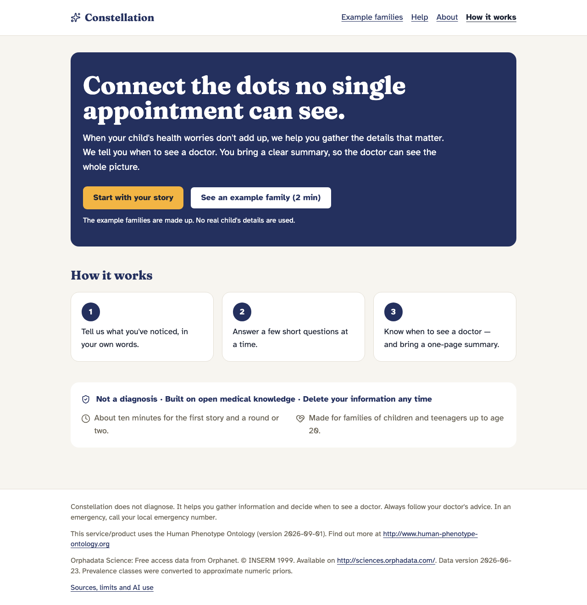
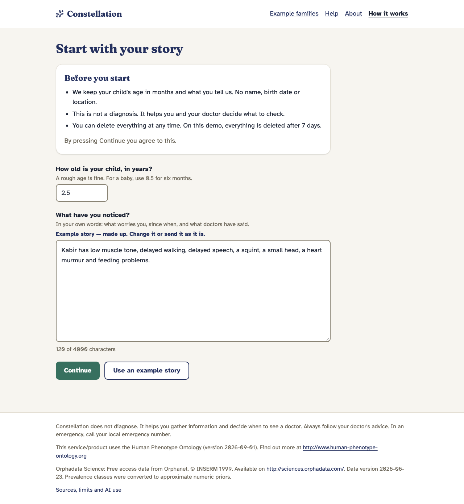
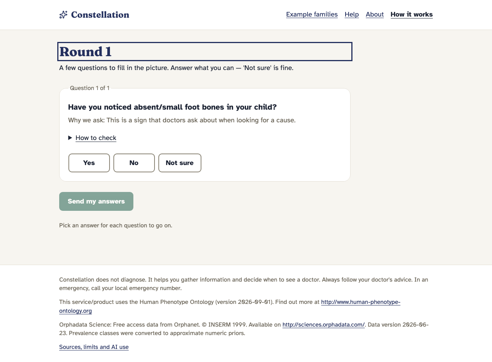
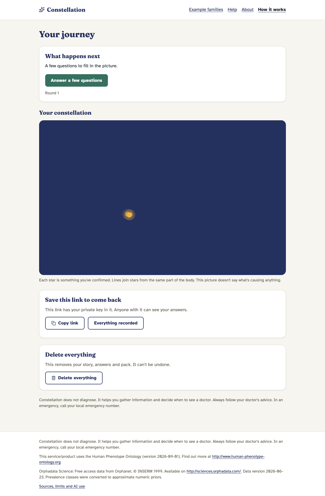
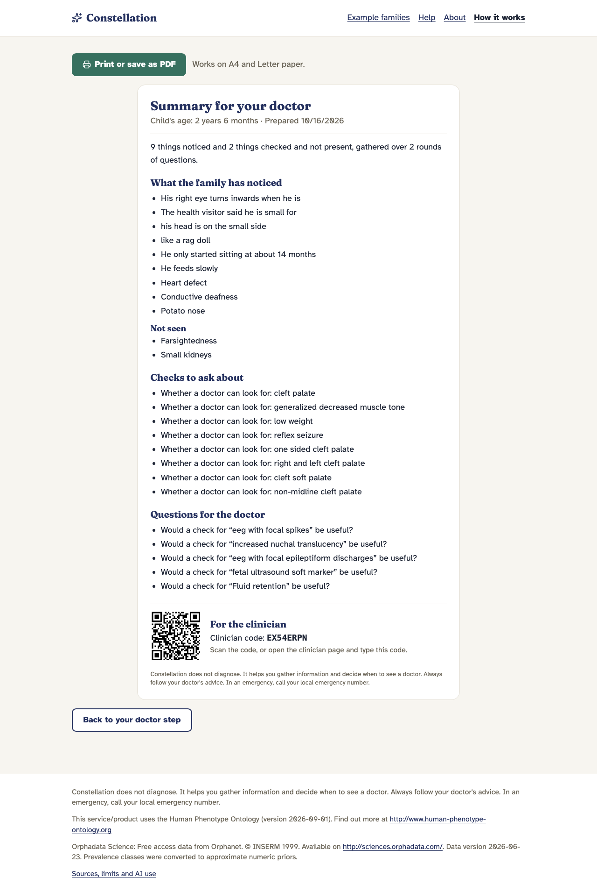
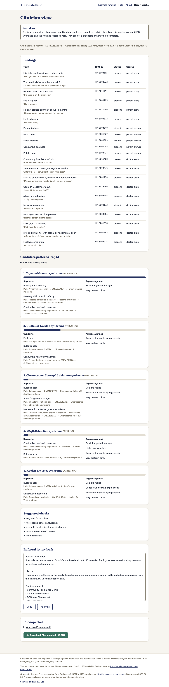
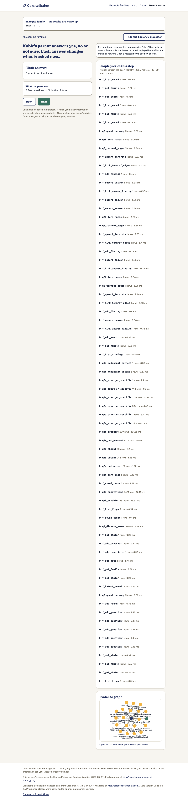
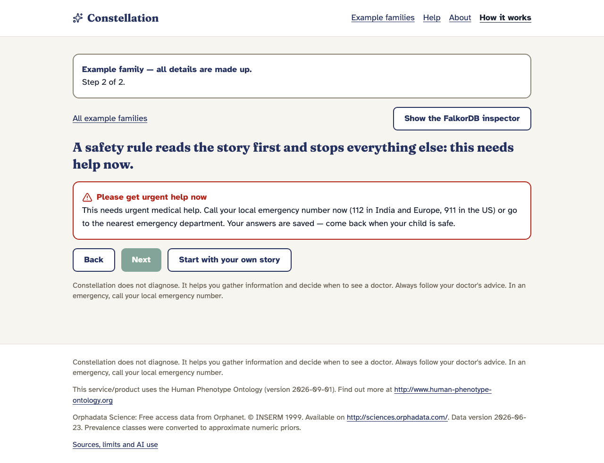

# Constellation: a 5-minute tour

Constellation is **not a diagnosis tool**. It helps families of children and teenagers (0 to 20) collect the right evidence and reach the right
specialist sooner. This tour has four stops, one per kind of visitor. All families, clinics and cases you see are **made up or synthetic**.

Start the app with the three commands in the [README](../README.md#3-try-it), then open <http://localhost:8080>. Screenshots are from
`docs/explain/P4-screens/` (1280 px wide; the app is built for phones first).

## 1. If you are a parent (about 2 minutes)

1. On the first page choose **Use an example story**. It is a made-up family, clearly labelled. (To use your own, write in your own words;
   no names or dates are needed, just your child's age.)
2. The example story is confirmed for you so you reach the questions in two clicks. With your own story you first get
   **Check what we understood**: a plain-words list of what the app heard, which you correct before anything is kept.
   
3. **Answer a round of questions** (three to five). Each has a short reason and a "how to check at home" hint. **Not sure** is always a fine answer.
   
4. **Your journey** shows what has happened so far and what to do next. Safety checks run on everything you type; an emergency stops the flow
   with a red, clearly marked screen and the local emergency numbers.
   
5. When the evidence is strong enough you are told it is a good time to **see a doctor** and get a **one-page doctor pack** (print it, or show it
   on a phone). You will never see a disease name, probability or ranking.
   

*Worked example: Kabir, 30 months.* His parent describes a floppy baby, slow motor milestones, and trouble with feeding. After two home rounds
the app says "see a doctor" and produces the pack. After the doctor's findings come back it prepares referral-ready notes. The same
journey is available, recorded, at `/demo/kabir`.

## 2. If you are a clinician (about 1 minute)

The pack carries a QR code and a short code. Opening it leads to the **clinician view**: the findings with where each came from (story,
answer, document), suggested checks, and, only here, the candidate conditions with the mandatory disclaimer. You can download a
**GA4GH Phenopacket v2** file and see a drafted referral letter.

*Worked example:* open `/demo/kabir`, go to the last step, and choose the clinician view. Each candidate has an explanation path through the
phenotype ontology ("this sign is a kind of that sign, which this condition is known for").

## 3. If you run a clinic (about 1 minute): **Clinic centre**

Open **Clinic centre** in the header. It shows a synthetic clinic's memory (labelled "Illustrative clinic data"): for a case, the **five closest
solved look-alikes, who solved them, and with which protocol**; **signs that bridge groups of cases**; groups of related cases; free
questions such as "Which protocol is fastest?" (answered from templates, never free-form database access); notes; and a **knowledge-update
check** that copies the graph and shows which open cases would change if the knowledge base were updated.

*Worked example:* choose an open case, read the routing table, then press **Which protocol is fastest?**. The query log below the page shows the Cypher
FalkorDB ran, with timings.

## 4. If you are a judge (about 1 minute)

Open **/demo**, pick a journey, and switch on **Show the FalkorDB inspector**.

- For every step you see the registry queries that ran, their Cypher, how many rows came back and how long they took (the example families were
  recorded against the real graph; the clinic centre's inspector is live).
- **Kabir** goes from story to referral, **Arjun** ends in reassurance (no escalation), **Maya** hits a red flag and stops straight away with
  no language-model call.

  

- Numbers behind the claims are in the [README evaluation section](../README.md#6-evaluation), which also says plainly where the system does
  **not** beat the simple baselines.

## Good to know

- No account is needed. Save the journey link to come back; everything can be deleted from the journey page, and the public demo deletes
  families after 7 days.
- "How it works" in the header reopens the short tour on any page.
- Questions? See [Help](http://localhost:8080/help) in the app, or [docs/explain/](explain/) for plain-English notes on how each part was built.
