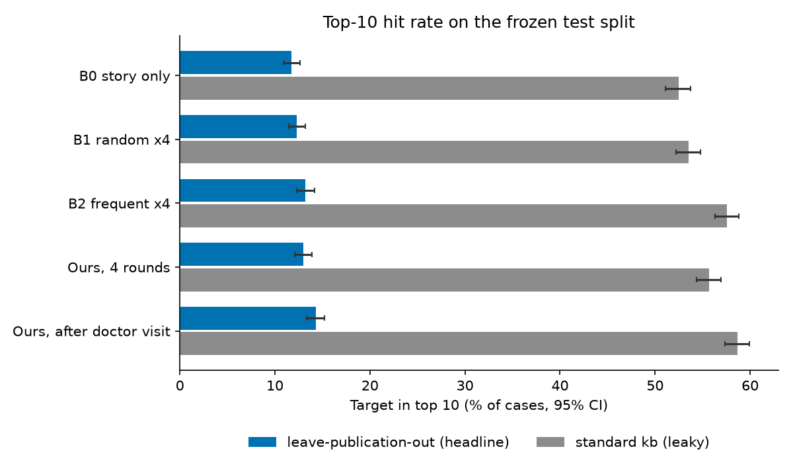
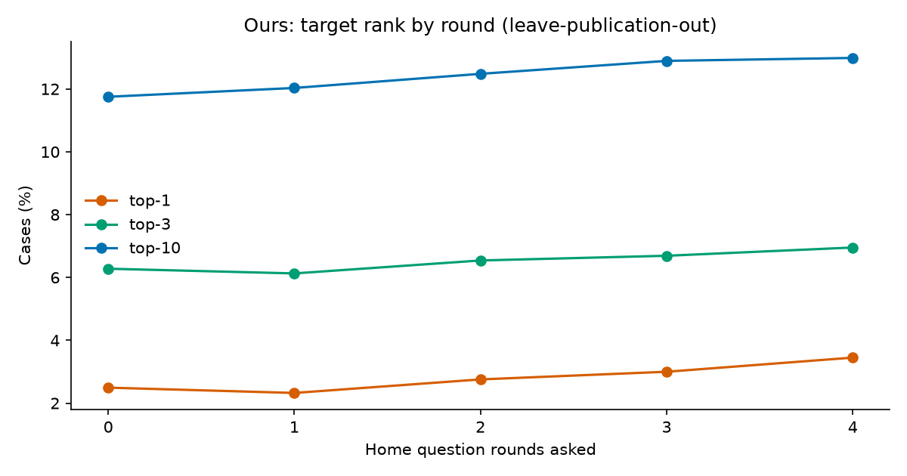
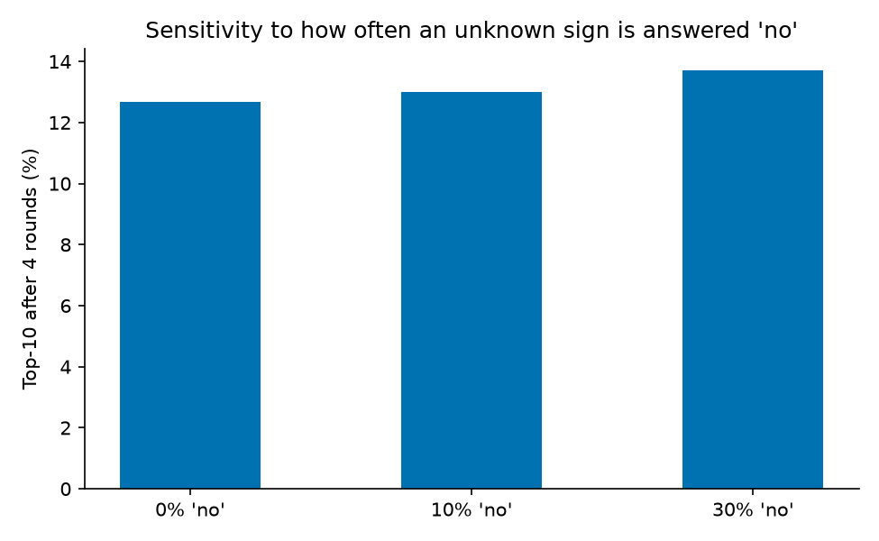

# Evaluation report (test split, 2026-10-16)

**Honest framing.** Real published cases (Phenopacket Store 0.1.27) with *simulated* parent answers. Not a clinical validation. Published figures for other systems (GPT-4 19.2% top-1 / 32.5% top-10; Exomiser phenotype-only 35.5% top-1; DeepRare 57.18% Recall@1) are context only: different datasets and settings.

- Split file SHA-256 (expected): `223e60764140a0c696b991e828e742e7fe9c43293f30444494e0c3ef9791b6d5`; split size 7496; cases evaluated **5336** (fixed on the standard kb, ADR-0013).
- Target still annotated in the leave-publication-out kb: 3657 cases; the rest count as misses in the headline.
- Coverage (P1): 99.7% of all store cases resolve on the standard kb; 68.7% of test cases resolve on lpo.
- kb `kb_20260901`; taus [0.3, 0.4, 0.5]; `config/engine.yaml` SHA-256 `3f624b0dc669d302…`.
- Query errors after retries (unresolved): {'lpo:ours:0.10': 0}.

## Headline: leave-publication-out kb, all cases in the list

n = 5336 cases. Hit rule: exact mappings only.

| Method | top-1 % [95% CI] | top-3 % | top-10 % | MRR | median rank |
|---|---|---|---|---|---|
| B0 story only | 2.5 [2.1, 2.9] | 6.3 [5.6, 7.0] | 11.8 [10.9, 12.7] | 0.057 | 4170 |
| B1 random x4 | 2.7 [2.3, 3.1] | 6.4 [5.7, 7.1] | 12.3 [11.4, 13.2] | 0.059 | 2512 |
| B2 frequent x4 | 3.6 [3.1, 4.1] | 6.9 [6.2, 7.6] | 13.2 [12.3, 14.1] | 0.067 | 1128 |
| Ours, 4 rounds | 3.4 [3.0, 4.0] | 7.0 [6.3, 7.7] | 13.0 [12.1, 13.9] | 0.066 | 1552 |
| Ours, after doctor visit | 3.8 [3.3, 4.3] | 7.8 [7.0, 8.5] | 14.3 [13.4, 15.2] | 0.072 | 1304 |

Paired top-10 gain of Ours (4 rounds) over: B0 +0.7 to +1.7 pts; B1 +0.2 to +1.2 pts; B2 -0.7 to +0.3 pts

Mean questions asked: 17.9; median round latency 279 ms (p90 465 ms).

## Standard kb (leaky; context only)

n = 5336 cases. Hit rule: exact mappings only.

| Method | top-1 % [95% CI] | top-3 % | top-10 % | MRR | median rank |
|---|---|---|---|---|---|
| B0 story only | 17.1 [16.2, 18.2] | 34.9 [33.6, 36.2] | 52.5 [51.1, 53.7] | 0.293 | 9 |
| B1 random x4 | 19.9 [18.9, 21.0] | 37.2 [35.9, 38.5] | 53.5 [52.2, 54.8] | 0.316 | 8 |
| B2 frequent x4 | 24.8 [23.6, 25.8] | 42.3 [40.9, 43.6] | 57.6 [56.3, 58.8] | 0.362 | 6 |
| Ours, 4 rounds | 22.6 [21.5, 23.7] | 39.0 [37.7, 40.4] | 55.7 [54.3, 57.0] | 0.339 | 7 |
| Ours, after doctor visit | 27.5 [26.2, 28.7] | 42.9 [41.6, 44.2] | 58.7 [57.4, 60.0] | 0.381 | 5 |

Paired top-10 gain of Ours (4 rounds) over: B0 +2.4 to +4.1 pts; B1 +1.3 to +3.1 pts; B2 -2.7 to -1.0 pts

Mean questions asked: 18.6; median round latency 322 ms (p90 502 ms).

## Leave-publication-out, only cases whose target is still annotated

| Method | top-1 % [95% CI] | top-3 % | top-10 % | MRR | median rank |
|---|---|---|---|---|---|
| B0 story only | 3.6 [3.0, 4.2] | 9.2 [8.2, 10.1] | 17.1 [15.9, 18.4] | 0.083 | 240 |
| B1 random x4 | 4.0 [3.4, 4.6] | 9.3 [8.4, 10.2] | 17.9 [16.7, 19.2] | 0.087 | 236 |
| B2 frequent x4 | 5.2 [4.5, 5.9] | 10.1 [9.1, 10.9] | 19.3 [18.0, 20.5] | 0.098 | 177 |
| Ours, 4 rounds | 5.0 [4.3, 5.7] | 10.1 [9.2, 11.0] | 18.9 [17.7, 20.2] | 0.096 | 191 |
| Ours, after doctor visit | 5.6 [4.8, 6.3] | 11.3 [10.3, 12.4] | 20.8 [19.6, 22.2] | 0.105 | 165 |

## Referral behaviour (fixed taus)

| kb | referral sensitivity | see a doctor | watch | median rounds to see-doctor |
|---|---|---|---|---|
| lpo | 12.8% | 58.8% | 41.2% | 1 |
| std | 16.7% | 68.6% | 31.4% | 1 |

## Synthetic negatives (40 reviewed vignettes)

| kb | false referral | false see-doctor | safety-rules-only floor |
|---|---|---|---|
| lpo | 0.0% | 22.5% | 0.0% |
| std | 0.0% | 22.5% | 0.0% |

## Sensitivity to the simulated parent (lpo, Ours)

| unknown sign answered 'no' | top-1 % | top-10 % (4 rounds) | top-10 % after doctor | referral sensitivity |
|---|---|---|---|---|
| 0% | 3.3 [2.9, 3.8] | 12.7 [11.8, 13.5] | 13.8 [13.0, 14.8] | 12.9% |
| 10% | 3.4 [3.0, 4.0] | 13.0 [12.1, 13.9] | 14.3 [13.4, 15.2] | 12.8% |
| 30% | 4.2 [3.7, 4.7] | 13.7 [12.8, 14.7] | 15.0 [14.0, 16.0] | 9.6% |

## Threshold sweep (report only; no re-tuning on the test split)

- lpo: 73 of 282 tau triples meet the pre-declared limits (false referral <= 10%, false see-doctor <= 30%); sensitivity range among them [0.06371814092953523, 0.14430284857571216]; best by the pre-registered rule {'taus': [0.2, 0.3, 0.5], 'sensitivity': 0.14430284857571216, 'false_referral': 0.0, 'false_see_doctor': 0.275}.
- std: 73 of 282 tau triples meet the pre-declared limits (false referral <= 10%, false see-doctor <= 30%); sensitivity range among them [0.10700899550224888, 0.18440779610194902]; best by the pre-registered rule {'taus': [0.2, 0.3, 0.5], 'sensitivity': 0.18440779610194902, 'false_referral': 0.0, 'false_see_doctor': 0.275}.

## Charts

